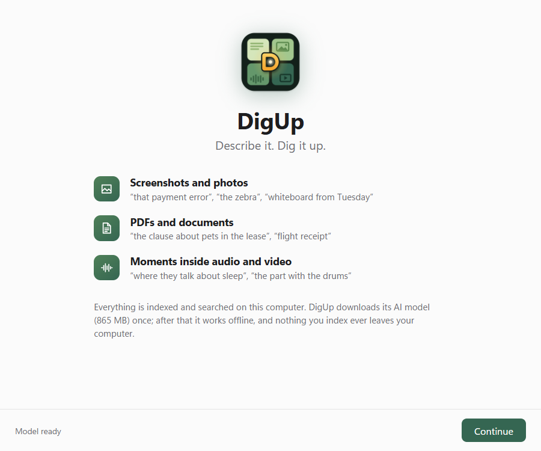
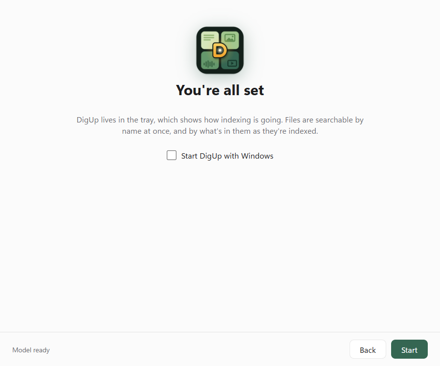

<p align="center"></p>

<h1 align="center">DigUp for Windows</h1>

<p align="center"><b>Describe it. Dig it up.</b><br>
Search the files on your PC by what's in them, with Google DeepMind's
<a href="https://huggingface.co/google/embeddinggemma-2">EmbeddingGemma 2</a>. Private, offline, free.</p>

<p align="center">
  <a href="https://github.com/ajisrawi/DigUp-Windows/releases/download/v0.1.0/DigUp_0.1.0_x64-setup.exe"></a>
</p>

<p align="center">
  <a href="https://github.com/ajisrawi/DigUp-Windows/releases"></a>
  
  <a href="LICENSE"></a>
  <a href="https://github.com/ARahim3/DigUp"></a>
</p>

<p align="center"></p>

DigUp finds files by what they show or say, not just their names. Type "the clause about pets in the lease" and it
opens the right PDF page. Type "payment declined error" and it finds the screenshot. Type in English and it finds a
note written in Arabic or Bengali. Everything runs on your PC: nothing you index ever leaves it.

This is the Windows version of [DigUp](https://github.com/ARahim3/DigUp) by ARahim3, packaged as a normal Windows
app with a tray icon, a global shortcut and an installer.

## Install

1. **[Download the installer](https://github.com/ajisrawi/DigUp-Windows/releases/download/v0.1.0/DigUp_0.1.0_x64-setup.exe)**
   and run it. It installs for your account only; no admin rights needed.
2. Windows SmartScreen may warn that the app isn't signed yet: click **More info → Run anyway**.
3. Pick the folders to search. The AI model (865 MB) downloads once while you do; after that DigUp works offline.
4. Press **Ctrl+Shift+Space** in any app and describe what you're looking for.

All versions and release notes are on the [Releases page](https://github.com/ajisrawi/DigUp-Windows/releases).

## What you can find

- **Pictures and screenshots** by what they show: "a dog on the beach", "the payment error"
- **PDFs and documents** page by page: "the clause about pets in the lease", "flight receipt"
- **Moments in audio and video**: "where they talk about sleep" jumps to that minute
- **Across languages**: a search in English finds a note in Arabic, Bengali or any of the model's 100+ languages
- **Exact words** too: invoice numbers, error codes and names are matched as written

## Using it

| Key | What it does |
|---|---|
| **Ctrl+Shift+Space** | Opens the search panel from any app |
| **↑ ↓** | Moves through the results |
| **Enter** | Opens the result |
| **Ctrl+Enter** | Shows it in File Explorer |
| **Esc** | Closes the panel |

DigUp lives in the system tray. Right-click its icon to see how indexing is going (the top line), choose folders,
index now, or turn **Start with Windows** on or off.

<p align="center"></p>

## Private by design

DigUp goes online only to download the model, once. No account, no telemetry, no cloud. It only reads the folders you
choose, and it never changes, moves or uploads your files. It skips hidden folders, AppData, keys and password files,
and it doesn't download OneDrive files that live only in the cloud.

## Good to know

This is a preview release. Known limits:

- **CPU only** for now, so the first pass over a big folder takes a while. After that, new files are searchable
  seconds after they land.
- **Inside a code project** (a folder with `.git`, `package.json` and the like), only screenshots are indexed.
- **The installer isn't code-signed yet**, hence the SmartScreen warning.
- **To uninstall**, use Settings → Apps. The model and index stay in `%LOCALAPPDATA%\DigUp`; delete that folder to
  remove everything.

## How it works

```
your folders ─► readers (PDFium for PDFs, stb for pictures, ffmpeg for audio, video and HEIC; all included)
             ─► EmbeddingGemma 2 on llama.cpp, in a helper process
             ─► one SQLite file: a vector for every picture, page, passage, video frame and 30 s of sound,
                plus a keyword index
your words   ─► the same model's text part ─► nearest vectors + exact words
```

The app is a [Tauri](https://tauri.app) tray shell (`shell/`) over DigUp's Swift engine (`Sources/`), which runs as a
helper process. Every vector lives in one 768-dimensional space, so one query can rank a video frame against a PDF page.

## Build from source

With Visual Studio 2022 (C++ workload), Git for Windows, Python 3, the [Swift toolchain](https://swift.org/install)
(6.4+), Rust and Node.js installed:

```powershell
powershell -ExecutionPolicy Bypass -File scripts\build-windows.ps1
# → shell\src-tauri\target\release\bundle\nsis\DigUp_<version>_x64-setup.exe
```

It builds llama.cpp with MSVC (CPU backends; CUDA or Vulkan when their SDKs are found) and the `digup` helper, stages
the helper with its DLLs and a pinned LGPL build of ffmpeg 8.1, and packages a per-user installer. The helper is also a command-line tool:
`digup estimate`, `digup index`, `digup search` (`digup --help`).

## Credits

DigUp is created by [ARahim3](https://github.com/ARahim3/DigUp). All credit for the app and its search engine goes to
the original author; this repository brings it to Windows. For the Mac app and its documentation, see
[ARahim3/DigUp](https://github.com/ARahim3/DigUp).

Built on [EmbeddingGemma 2](https://huggingface.co/google/embeddinggemma-2) by Google DeepMind (Apache 2.0),
[llama.cpp](https://github.com/ggml-org/llama.cpp) (MIT), [PDFium](https://pdfium.googlesource.com/pdfium/),
[FFmpeg](https://ffmpeg.org) (LGPL, an unmodified build from [BtbN/FFmpeg-Builds](https://github.com/BtbN/FFmpeg-Builds))
and [Tauri](https://tauri.app). DigUp isn't affiliated with Google or Microsoft. Gemma is a trademark of Google LLC;
Windows is a trademark of Microsoft Corporation.

## License

MIT, as the original. See [LICENSE](LICENSE).
